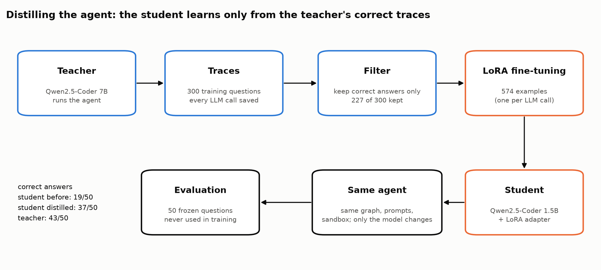

<div align="center">

# Agent Distillation

**A 1.5B model trained on the traces of a 7B model runs the [Data Analyst Agent](https://github.com/ALI-AL-MARJANI/Data-Analyst-Agent):<br>37/50 correct answers against 43/50 for the 7B, about 3 times faster.**

</div>

---

## In short

- I fine-tuned Qwen2.5-Coder **1.5B** on the correct answers of Qwen2.5-Coder **7B**, inside the same agent. It went from **19/50** to **37/50** correct answers. The 7B gets 43/50.
- On the 30 held-out questions, the small model gets **25/30**, against 26/30 for the 7B.
- It answers in **6.4 s** instead of 20.8 s and needs 1.53 GB of memory instead of 5.34 GB, on a 16 GB MacBook.

## How it works

<p align="center"></p>

1. The teacher runs the agent (LangGraph: it writes pandas code, runs it in a sandbox, retries on errors) on 300
   template questions about 1 million sales rows. Every LLM call is saved.
2. **Rejection sampling:** only the traces whose final answer matches a pandas reference answer are kept, 227 of 300.
3. **LoRA** on the 574 LLM calls of those traces, with MLX on the Mac: 51 min.
4. The student runs in the exact same agent, pinned to one commit. Only the model name changes. It is tested on 50
   questions never used for training: the agent's 20 dev questions and 30 **held-out** questions, kept aside to
   test on unseen questions.

## Results

| Model | Correct (50) | dev (20) | held-out (30) | Avg retries | Latency p50 | Memory |
|---|---:|---:|---:|---:|---:|---:|
| Student, before fine-tuning | 19/50 | 7/20 | 12/30 | 1.04 | 11.4 s | 1.53 GB |
| Student, distilled | 37/50 | 12/20 | 25/30 | 0.21 | 6.4 s | 1.53 GB |
| Teacher | 43/50 | 17/20 | 26/30 | 0.09 | 20.8 s | 5.34 GB |

Same Ollama version and 4-bit quantization for all three ([`results/tables.md`](results/tables.md)).

## Where the small model still fails

13 failures, read one by one ([`results/error_analysis.md`](results/error_analysis.md)). 4 of them are mistakes
the teacher makes too.

- **Wrong aggregation (4):** `isna() | col == ''` counts 0 rows, because `|` binds before `==`.
- **Answers questions the data can't answer (3):** it invents `cost_price = 1` to compute a profit.
- **Drops part of the question (3):** it forgets "apart from the United Kingdom".
- **Computes the answer but doesn't store it in `result` (2)**, and 1 crash its retries never fixed.

## Limitations

- **The teacher is not perfect.** 34 of its 300 traces were wrong refusals ("no row mentions Brazil": it only sees 5
  sample rows). The filter removes them, but some question types become rare: 2 of 13 revenue-by-country kept.
- **The served prompt first differed from the training prompt.** Ollama 0.18.2 merges two consecutive user messages,
  which is what the agent's retry prompt sends. Training examples now get the same merge, checked token by token
  against the real server. Ollama 0.40 stopped merging them, so the results are tied to 0.18.2.
- **One run, one seed, 50 questions:** one question is 2 points. The student is weaker on dev (12/20) than on
  held-out (25/30). That gap is not explained by how close the questions are to the training set, and a Fisher
  test gives p = 0.10, so it may be chance.

Next: several seeds, to know if 37/50 is stable or lucky. Then DPO on impossible questions, to teach the student to
refuse instead of inventing data.

## Reproduce

Needs Ollama 0.18.2.

```bash
uv sync --all-extras && source .venv/bin/activate
python scripts/run_teacher.py --batch 1          # teacher traces (then --batch 2, 3), ~35 min each
python scripts/filter_traces.py                  # rejection sampling
python scripts/train.py                          # LoRA fine-tuning, ~51 min
python scripts/evaluate.py --config configs/student_distilled.yaml
```

## Repo structure

```
configs/        teacher, students, LoRA and data settings; chat templates (Hugging Face, Ollama)
data/eval/      50 frozen evaluation questions + reference answers, never used for training
data/train/     300 template questions + reference answers
data/traces/    teacher traces: every LLM call of every question
src/distill/    question templates, leakage check, trace recorder, filter, chat format, metrics
scripts/        one script per step, in RUNBOOK.md order
results/        leakage report, filter report, training run, evaluations, tables, error analysis
docs/           architecture.png (scripts/make_architecture.py)
tests/          offline tests (no model, no Ollama) + one slow check against the real Ollama server
```
